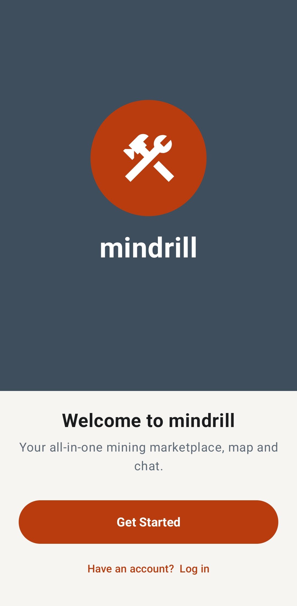
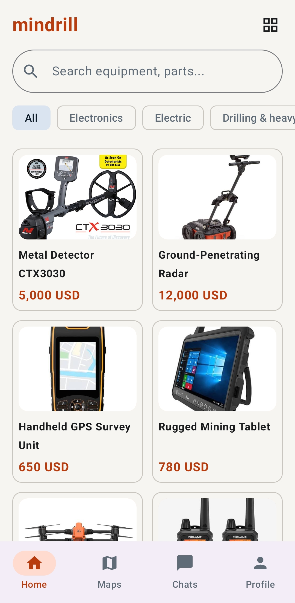
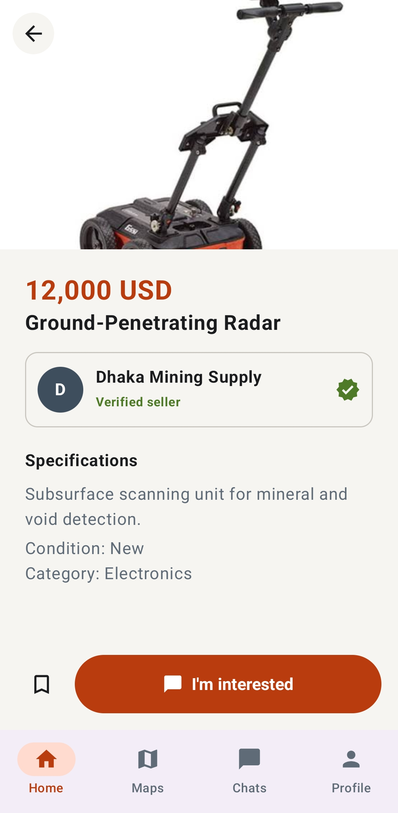
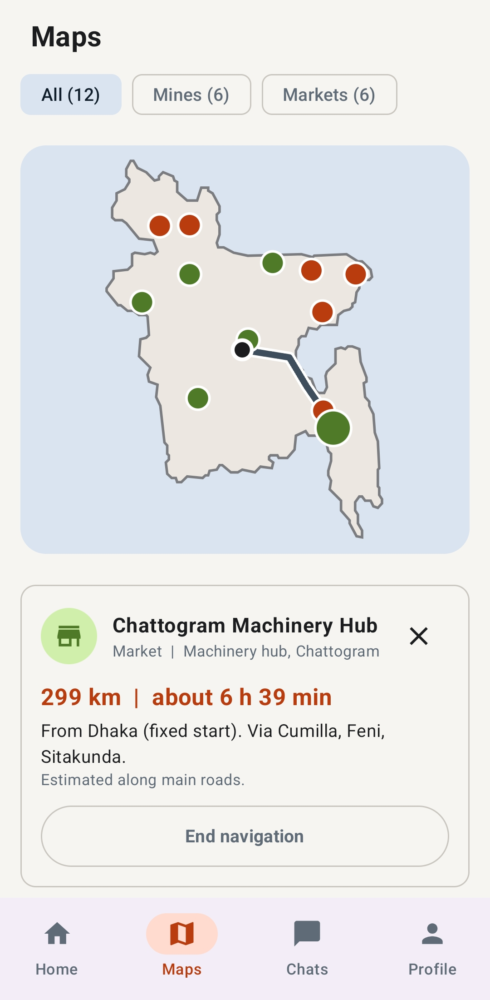
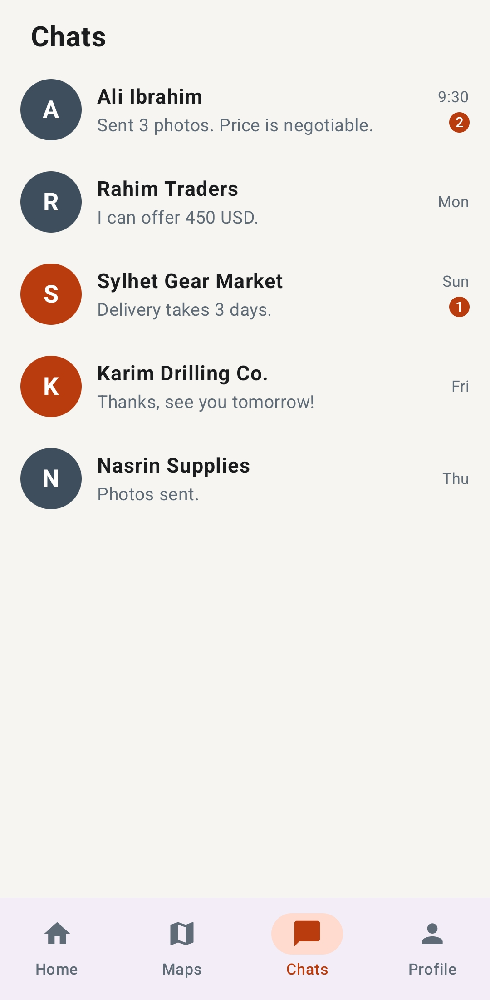
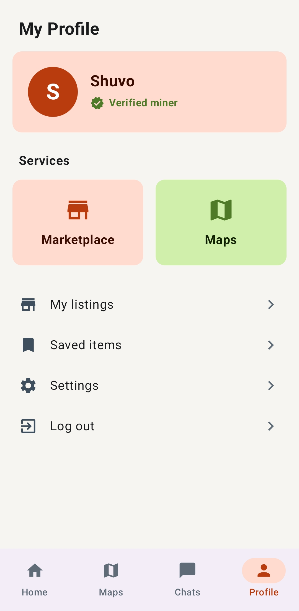

# mindrill

**Your all-in-one mining marketplace, map and chat.**

mindrill is a native Android app for the mining community in Bangladesh. People can browse and list mining equipment, find mines and markets on a map, get an estimated route from a fixed start point, and chat with sellers. It is a university project and a working prototype with sample data.

## Screenshots

| Welcome | Marketplace | Product detail |
|:---:|:---:|:---:|
|  |  |  |

| Maps with route | Chats | Profile |
|:---:|:---:|:---:|
|  |  |  |

## Features

- **Onboarding:** welcome, location and 18+ consent, identity details and a 6-digit code step. The app remembers you after the first login.
- **Marketplace:** 36 sample products across six categories (Electronics, Electric, Drilling and heavy, Safety gear, Tools and parts, Wanted), with search, category filters, product photos and a product detail page.
- **Maps:** a Bangladesh map with 12 sample locations split into All, Mines and Markets. Tap a pin for details, then get directions from a fixed start point (Dhaka) with an estimated distance and travel time, drawn inside the app.
- **Chat:** conversation list with unread counts and a message screen. "I'm interested" on a product opens a chat with the seller and sends the first message.
- **Profile:** your details, saved items (bookmarks), your own listings with photo, edit and delete, and a dark mode setting.

## Design

- Material Design 3 with a custom "Ember and Basalt" palette: hi-vis rust orange, basalt slate and lichen green, chosen to match mining safety gear and stay readable in sunlight.
- Light and dark themes.
- The design was first drawn as SVG screens (360 x 800) so it can be imported into Figma.

## Tech stack

- Kotlin
- Jetpack Compose with Material 3
- Android Studio, Gradle (Kotlin DSL), minimum SDK 26 (Android 8.0)
- Local storage with SharedPreferences and app-private files (no server)

## Run the project

1. Clone the repository:
   ```
   git clone <this-repo-link>
   ```
2. Open the folder in Android Studio and wait for Gradle sync to finish.
3. Pick an emulator or a connected Android phone and press **Run**.

## Project structure

```
app/src/main/java/com/mindrill/app/
  MainActivity.kt   entry point
  Onboarding.kt     welcome, consent, identity and code screens
  MindrillApp.kt    bottom navigation and app state
  Marketplace.kt    home, categories and product detail
  Products.kt       sample products and categories
  Maps.kt           Bangladesh map, pins and route drawing
  Routing.kt        simplified road network and shortest route
  Chat.kt           chat list and conversation
  Profile.kt        profile, listings, saved items, settings
  Storage.kt        saved settings, listings and photos
```

## Limitations

- All products, locations and chats are sample data. There is no server, so messages and listings stay on the device.
- The code step is a demo: any 6 digits are accepted.
- Routes are estimates drawn on a simplified network of main cities and highways, not real turn-by-turn directions.
- Only some products have photos; the rest show a category icon.

## Roadmap

- Real account verification and a backend for listings and chat
- Real road routing and live location
- More product photos and seller ratings

## Author

Shuvo Sarkar, Dongshin University